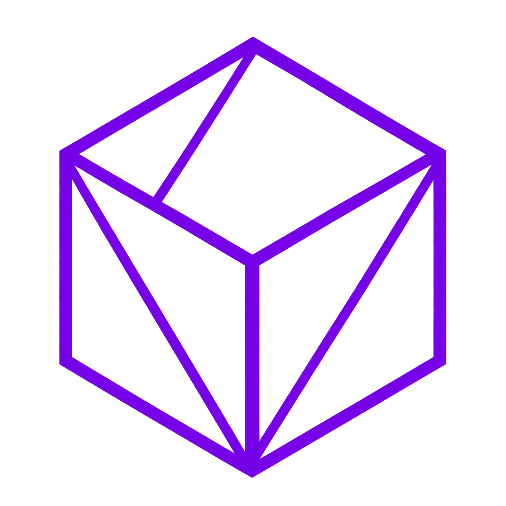
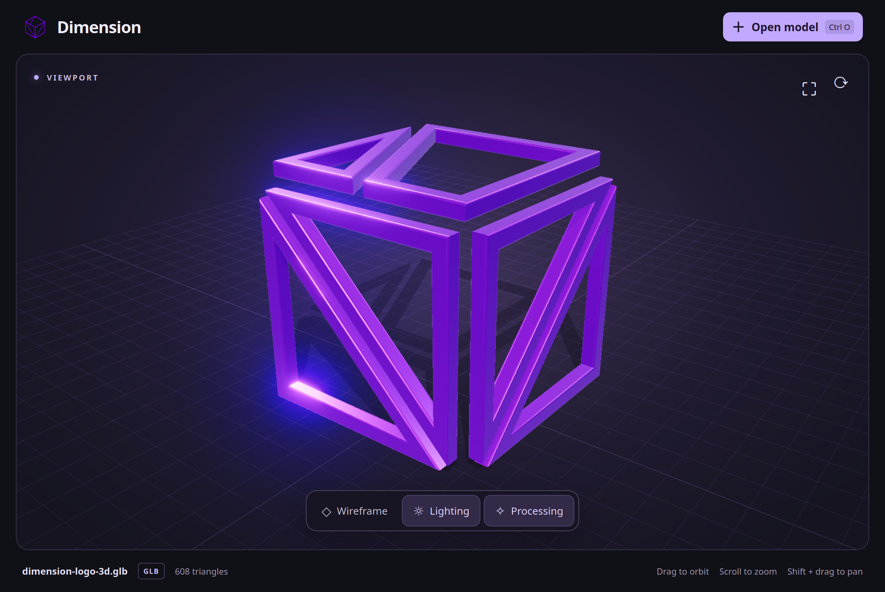

# Dimension



Dimension is a standalone Ubuntu viewer for 3D models. It opens in a native GTK window and renders locally. The renderer and model decoders are bundled, so opening models requires no network access or external conversion software.

## Screenshots

**Studio lighting and bloom**


**Wireframe mode**


**3D logo model**



Try the [3D Dimension logo (.glb)](docs/models/dimension-logo-3d.glb) in the viewer.

## Install on Ubuntu

Run this from your desktop user's terminal. The installer verifies the package checksum and uses `sudo` to install the package for all users.

```sh
curl -fsSL https://raw.githubusercontent.com/caraveo/dimension/v0.0.2/install.sh | sh
```

You can also [download the .deb from GitHub Releases](https://github.com/caraveo/dimension/releases/tag/v0.0.2) and install it with:

```sh
sudo apt install ./dimension_0.0.2_all.deb
```

Open **Dimension** from Applications, double-click a supported model in Files, or run `dimension /path/to/model.usdz`. The curl installer also sets Dimension as the default for the desktop user who runs it. On other accounts, an explicit per-user file association takes precedence over the system default.

Dimension targets Ubuntu and compatible Debian-based desktop systems with GTK 3, WebKitGTK 4.1, and WebGL 2 support. APT installs the runtime packages when needed.

To uninstall:

```sh
sudo apt remove dimension
```

Dimension starts with a studio-lit sculpture. Use **Open model**, press **Ctrl+O**, or drop a local file onto the viewport. Keep sidecar files such as OBJ materials, glTF buffers, and textures in their original locations relative to the selected model.

| Action | Control |
| --- | --- |
| Orbit | Left drag |
| Pan | Shift + left drag or right drag |
| Zoom | Scroll |
| Frame model | F |
| Auto-rotate | R |
| Toggle wireframe | W |
| Toggle studio lighting | L |
| Toggle bloom | P |

Dimension can open GLB, glTF, USDZ, USD, USDA, USDC, OBJ, FBX, STL, PLY, DAE, 3DS, 3MF, AMF, PCD, VOX, VTK, and VTP. It previews static geometry and supported materials. Fidelity varies with format, shader, and scene features. USD packages using advanced composition or materials can preview differently from their authoring tools, and external assets must be available locally.

The bundled renderer is Three.js 0.187.0. Its MIT license is in `ui/vendor/LICENSE`.


## Run from source

```sh
sudo apt install python3-gi gir1.2-gtk-3.0 gir1.2-webkit2-4.1
./dimension.py /path/to/model.usdz
```

Build the Debian package and checksum with `./packaging/build-deb.sh`.
