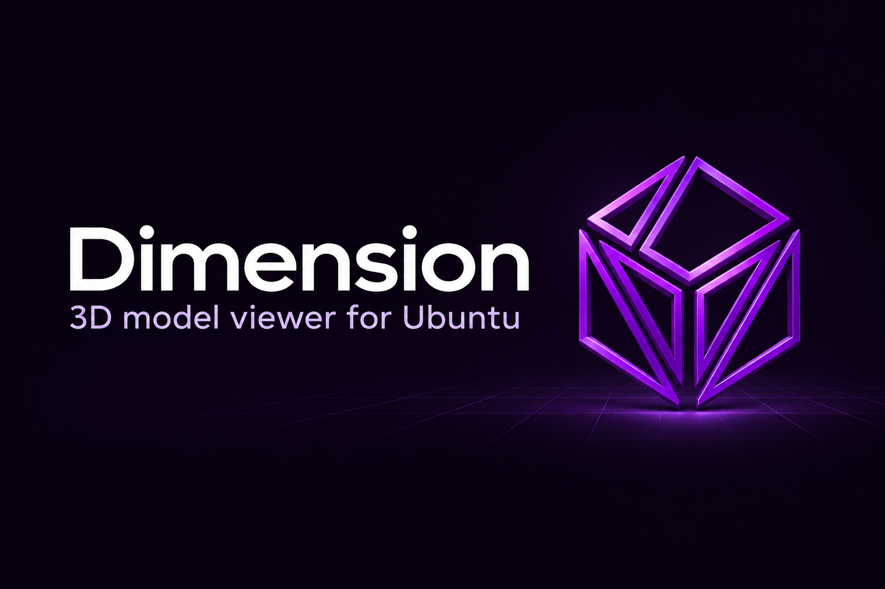
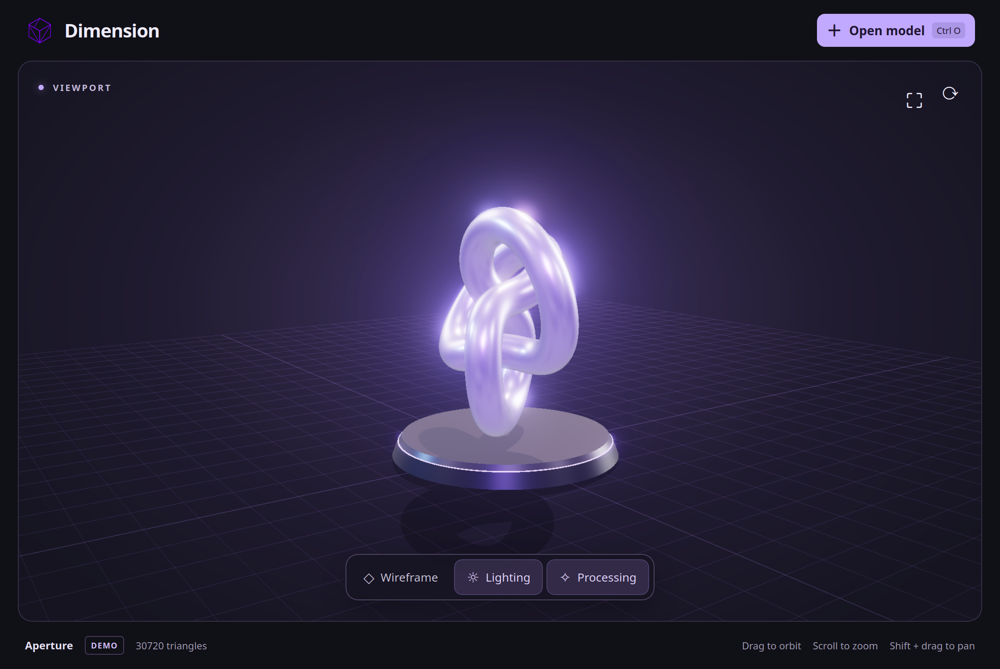
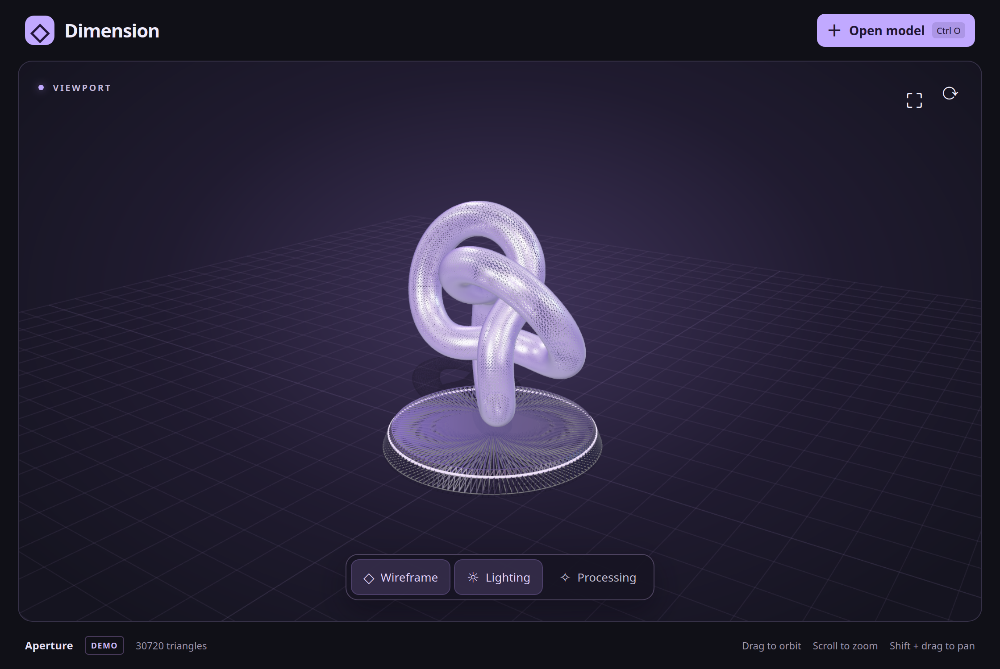
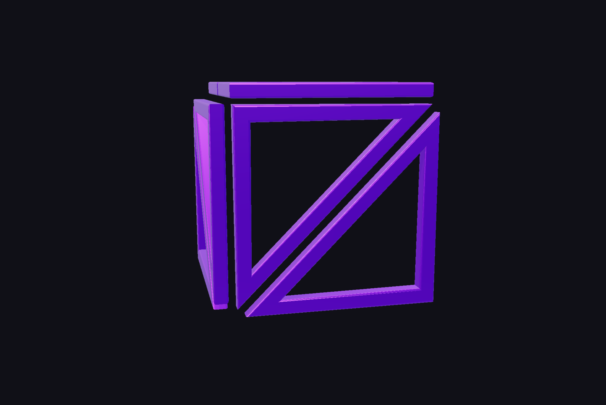

# Dimension



[](https://github.com/Caraveo/dimension/releases/latest)
[](https://github.com/Caraveo/dimension/releases)

[Install](#install-on-ubuntu) · [Screenshots](#screenshots) · [Shortcuts](#using-dimension) · [Supported formats](#supported-formats) · [Report an issue](https://github.com/Caraveo/dimension/issues)

Dimension is a standalone 3D model viewer for Ubuntu. Open USDZ, GLB, glTF, OBJ, FBX, STL, and other formats in a native GTK window. Rendering and model decoding run locally with no network access or external converter required.

- **Studio preview** with lighting, shadows, bloom, and wireframe.
- **Clean View** hides the floor and interface so you can orbit underneath the model.
- **Desktop integration** lets you open supported files directly from Ubuntu Files.

## Install on Ubuntu

Run this from your desktop user's terminal. The installer verifies the package checksum and uses `sudo` to install the package for all users.

```sh
curl -fsSL https://raw.githubusercontent.com/caraveo/dimension/v0.0.5/install.sh | sh
```

You can also [download the .deb from GitHub Releases](https://github.com/caraveo/dimension/releases/tag/v0.0.5) and install it with:

```sh
sudo apt install ./dimension_0.0.5_all.deb
```

Open **Dimension** from Applications, double-click a supported model in Files, or run `dimension /path/to/model.usdz`. The curl installer also sets Dimension as the default for the desktop user who runs it. On other accounts, an explicit per-user file association takes precedence over the system default.

Dimension targets Ubuntu and compatible Debian-based desktop systems with GTK 3, WebKitGTK 4.1, and WebGL 2 support. APT installs the runtime packages when needed.

To uninstall:

```sh
sudo apt remove dimension
```

## Screenshots

**Studio lighting and bloom**



**Wireframe mode**



**3D logo model**


Try the [3D Dimension logo (.glb)](docs/models/dimension-logo-3d.glb) in the viewer.

<details>
<summary>See the same model in Clean View</summary>



</details>

## Using Dimension

Dimension starts with a studio-lit sculpture. Use **Open model**, press **Ctrl+O**, or drop a local file onto the viewport. Keep sidecar files such as OBJ materials, glTF buffers, and textures in their original locations relative to the selected model.

| Action | Control |
| --- | --- |
| Orbit (drag underneath in Clean View) | Left drag |
| Pan | Shift + left drag or right drag |
| Zoom | Scroll |
| Frame model | F |
| Auto-rotate | R |
| Toggle wireframe | W |
| Toggle studio lighting | L |
| Toggle bloom | P |
| Enter Clean View | C |
| Leave Clean View | Esc |
| Shortcut guide | F1 |

**Clean View** hides the viewport backdrop, floor grid, demo podium, and interface controls. Left-drag upward in Clean View to orbit underneath the model. Press **Esc** to restore the full viewport and return to the upper half of the orbit. Dimension remembers Clean View, wireframe, lighting, processing, and auto-rotate when you switch models or restart. The shortcut guide opens on first launch and is available anytime with **F1**.

## Supported formats

Dimension can open GLB, glTF, USDZ, USD, USDA, USDC, OBJ, FBX, STL, PLY, DAE, 3DS, 3MF, AMF, PCD, VOX, VTK, and VTP. It previews static geometry and supported materials. Fidelity varies with format, shader, and scene features. USD packages using advanced composition or materials can preview differently from their authoring tools, and external assets must be available locally.

The bundled renderer is Three.js 0.187.0. Its MIT license is in `ui/vendor/LICENSE`.

## Run from source

```sh
sudo apt install python3-gi gir1.2-gtk-3.0 gir1.2-webkit2-4.1
./dimension.py /path/to/model.usdz
```

Build the Debian package and checksum with `./packaging/build-deb.sh`.
